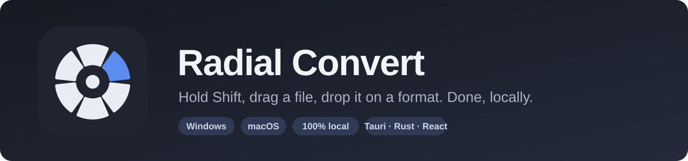
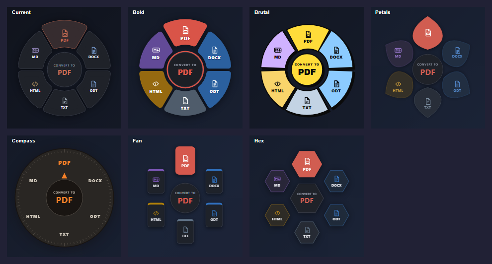
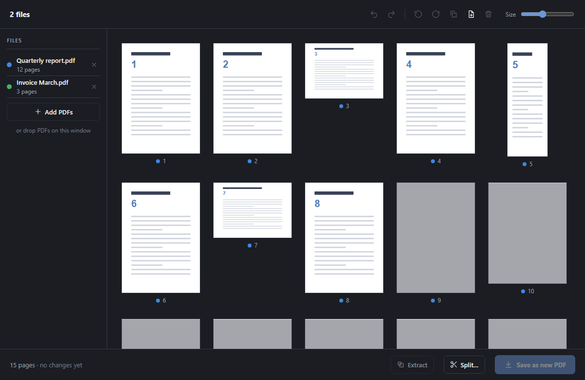
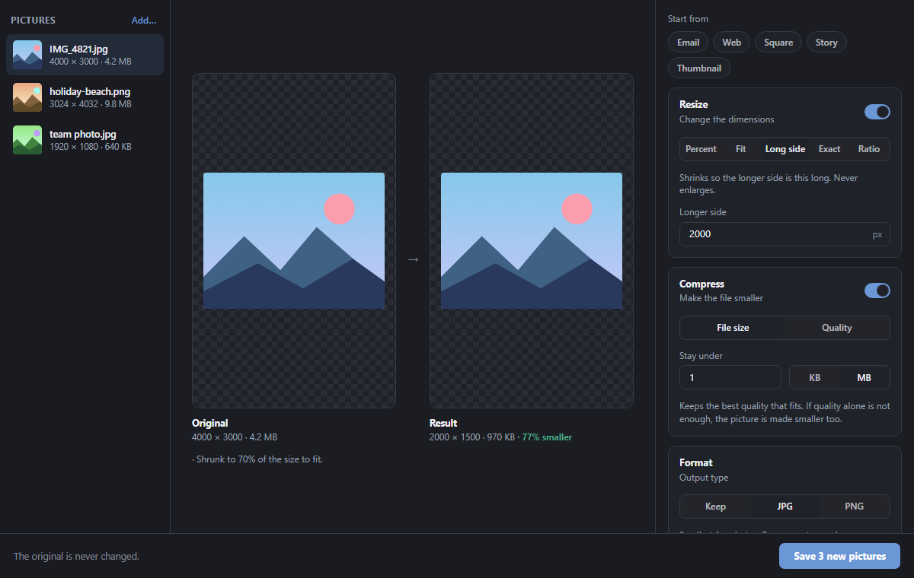
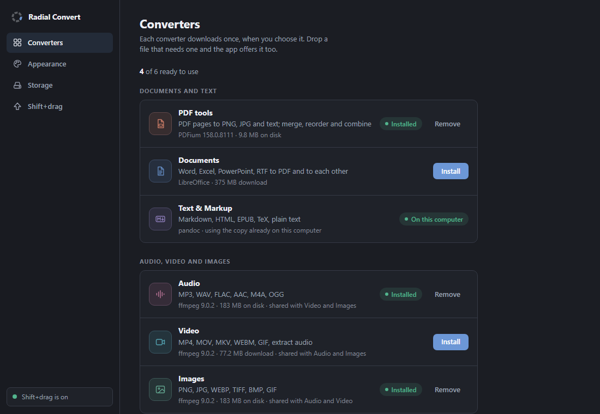

<div align="center">



<br>

[](https://github.com/Saransh1220/FileOrbit/actions/workflows/ci.yml)
[](LICENSE)


**Hold <kbd>Shift</kbd>, drag a file, and a ring of formats opens around your cursor.<br>Drop the file on one and it converts, right next to the original.**

[Features](#-features) ·
[How it works](#-how-it-works) ·
[Supported formats](#-supported-formats) ·
[Install](#-install) ·
[Development](#-development) ·
[Testing](#-testing) ·
[Project layout](#-project-layout) ·
[Docs](#-more-documentation)

</div>

---

<div align="center">

<br><sub>The ring, in the seven themes it ships with.</sub>
</div>

```text
report.docx  ──Shift+drag──▶  ( PDF  ODT  TXT  HTML  MD )  ──drop on PDF──▶  report.pdf
song.mp3     ──Shift+drag──▶  ( WAV  FLAC  AAC  M4A  OGG )  ──drop on WAV──▶  song.wav
3 PDFs       ──Shift+drag──▶  ( MERGE  ORGANIZE  PNG  JPG … )  ──drop on MERGE──▶  one PDF
holiday.png  ──Shift+drag──▶  ( JPG  WEBP  PDF  RESIZE … )  ──drop on RESIZE──▶  picture tool
```

No upload, no account, no browser tab. Converted files are written next to the originals and **an existing file is never overwritten** (a second conversion gives `report (1).pdf`).

---

## ✨ Features

### The ring

- **Shift + drag** a file out of Windows Explorer, the desktop or macOS Finder: a ring of target formats opens at the cursor. Release the file on a wedge to convert.
- The ring only offers what is possible: it reads the type of the dragged file(s) and shows the formats that file can become, **nothing else**. A file with no conversions gets no ring at all, and your normal drag is left alone.
- **Several files at once.** Select a few files, Shift+drag them, and the ring offers what they all have in common. Several PDFs (or PDFs and pictures) add a **Merge** wedge; several pictures add **Combine**. A mix with nothing in common (a PDF and a video) gets no ring.
- **Shift+click safe.** Explorer shrinks a multi-selection when Shift is held during a click; the app remembers your selection from just before and uses it.
- **Stays on screen.** The ring is moved so it is fully visible on the monitor under the cursor, in physical pixels, with the scale of that monitor.
- **Cancel with Esc** at any time; nothing is moved, copied or converted.
- **Tool wedges look different** from format wedges (a page-grid icon for *Organize*, a plus-page for *Merge*), so nobody expects a file out of them.
- **Drop on the centre** of the ring to open the page editor when the selection is a PDF.
- **Source is never moved.** The drop target always answers "copy".

### Converting files

- Local conversion with well-known open-source engines (LibreOffice, pandoc, ffmpeg, PDFium); see [Supported formats](#-supported-formats).
- **Batch jobs.** Dropping many files is one job with one toast ("3 of 8: report.docx") and one summary ("5 converted, 2 failed" with each reason).
- **Output next to the original**, never overwriting, with the same name and the new extension.
- **A real progress toast** for each job: running, done (with *Show* to reveal the file), or failed with a plain-language reason.
- **Honest errors.** A damaged file is reported by name and why; a failed conversion leaves no empty file behind.
- **HEIC and HEIF** (iPhone photos) to JPG or PNG on macOS.

### PDF tools

All of these use PDFium (the PDF library from Chrome), loaded from the optional *PDF tools* pack.

| Feature | What it does |
|---|---|
| **PDF to PNG / JPG** | Every page drawn at 150 dpi (long side capped at 7000 px). One page gives one file; several pages give a folder `name pages/` with `page 01`, `page 02`… JPG at quality 90. |
| **PDF to text** | All pages' text in one `.txt`, separated by page breaks. A scan with no text explains why instead of writing an empty file. |
| **PDF to Word / ODT** | Through LibreOffice's PDF import. Editable text; **layout may differ** (said honestly in the app). |
| **Picture to PDF** | A page in the picture's own proportions (long side A4's length), so there are no white bars. |
| **Merge** | Several PDFs (and pictures) into one PDF, in the order of your selection, named `first (merged).pdf`. |
| **Combine** | Several pictures into one PDF, one page each. |
| **Page editor** | See below. |

### The page editor (Organize)

Open it from the **Organize** wedge, or by dropping on the centre of the ring. Several PDFs open together in one window.

<div align="center">

</div>

- **Page grid** with lazy thumbnails (drawn only near the viewport, three at a time, so a 500-page file stays smooth) and a size slider.
- **Select** by click, <kbd>Ctrl</kbd>/<kbd>⌘</kbd>-click and <kbd>Shift</kbd>-click ranges.
- **Drag to reorder** one page or the whole selection, with an insertion bar, automatic scrolling at the edges and <kbd>Esc</kbd> to cancel.
- **Rotate** left or right, **delete**, **duplicate**, **insert a blank page** (sized like its neighbour).
- **Undo and redo**, for every change.
- **Several files in one editor**: a file rail with a colour tag per file, page counts (`3 of 12` once you delete some), *Add PDFs* (file chooser) and **drop PDFs on the window** to add them. Take a file out again from the rail.
- **Extract** the selected pages as their own PDF (`name (extract).pdf`).
- **Split** into several PDFs: every *N* pages, or typed ranges like `1-3, 5, 8-` with a live preview (`3 files: pages 1-3 · page 5 · …`). Parts are saved as `name (part 1).pdf`, `name (part 2).pdf`…
- **Save as new PDF** writes `name (edited).pdf` next to the original. The editor is non-destructive: it edits a list of page references, and the PDF is written only on save, validated first.
- **Safe to close**: asks before discarding unsaved changes; opens in front and focused.
- **Keyboard**: <kbd>Del</kbd> delete · <kbd>R</kbd> / <kbd>Shift+R</kbd> rotate · <kbd>Ctrl+Z</kbd> / <kbd>Ctrl+Y</kbd> undo / redo · <kbd>Ctrl+A</kbd> select all · <kbd>Ctrl+D</kbd> duplicate · <kbd>Ctrl+S</kbd> save · <kbd>Esc</kbd> clear selection.

### The picture tool (Resize / Compress)

Open it from the **Resize** wedge on any picture or group of pictures.

<div align="center">

</div>

- **Resize** by *percent*, *fit inside a box*, *longer side*, *exact size* or *aspect ratio* (1:1, 4:5, 3:2, 16:9, 9:16, or your own). Never enlarges when shrinking.
- **When proportions differ**: *crop*, *pad* with a background, or *stretch*.
- **Compress** to a fixed *quality* (1 to 100) or to **stay under a file size** ("under 500 KB", "under 1 MB"), keeping the best quality that fits.
- **Output format**: keep, JPG or PNG (GIF, WEBP, TIFF and BMP become JPG, or PNG if they have transparency).
- **One-click presets**: Email · Web · Square · Story · Thumbnail.
- **Live before / after preview** with the result's size, dimensions and "77% smaller".
- **Several pictures at once**, each saved as a new file next to its original. One failing does not stop the others. **The original is never changed.**
- Respects the photo's rotation (EXIF orientation).

### Converter packs

You download only the converters you choose. Missing one? Drop a file and the app offers to install it on the spot.

| Pack | Converts | Program | Approx. download |
|---|---|---|---|
| **PDF tools** | PDF pages to PNG, JPG, text; merge, reorder, combine, page editor | PDFium | 4 MB |
| **Documents** | Word, Excel, PowerPoint, RTF to PDF and to each other | LibreOffice | 375 MB |
| **Text & Markup** | Markdown, HTML, EPUB, TeX, plain text | pandoc | 42 MB |
| **Audio** | MP3, WAV, FLAC, AAC, M4A, OGG | ffmpeg | 77 MB |
| **Video** | MP4, MOV, MKV, WEBM, GIF, extract audio | ffmpeg | 77 MB (shared) |
| **Images** | PNG, JPG, WEBP, TIFF, BMP, GIF | ffmpeg | 77 MB (shared) |

- **Checksum-verified.** Every download is checked against a pinned SHA-256 in [`engines.manifest.json`](crates/radial-packs/engines.manifest.json).
- **Resumable and cached.** An interrupted download continues where it stopped (HTTP range requests); a verified download is kept so reinstalling never downloads it again.
- **Live progress** with speed and time left ("Downloading LibreOffice: 157 of 375 MB · 1.4 MB/s · 3 min left"), and a "Connecting" state while waiting on a slow network.
- **One install at a time**, so two packs sharing a program cannot corrupt each other.
- **Shared programs** (ffmpeg serves three packs) are downloaded once and removed only when no installed pack needs them.
- **Already installed?** Programs found on the computer (Homebrew, Program Files) are used and shown as *On this computer*.
- **No admin rights**: everything is installed in your own user folder.

### The manager window

<div align="center">

</div>

A sidebar and four pages, opened from the tray / menu-bar icon (*Manage converters*):

| Page | What it does |
|---|---|
| **Converters** | Install and remove packs, with sizes, versions, what each shares with another pack, and live install progress or the exact error. |
| **Appearance** | Choose the look of the ring, the toast and the window itself. |
| **Storage** | Space used by installed programs and by kept downloads; clear the download cache; open the data folder. |
| **Shift+drag** | Whether the shortcut is listening, and how to fix a missing permission (macOS Input Monitoring, Windows administrator windows). |

### Themes

Seven designs, switchable live from the tray's **Theme** menu or the Appearance page. The choice is remembered.

**Current** (follows your system light/dark) · **Bold** (dark graphite, blue accent) · **Brutal** (pale yellow, black outlines, hard edges) · **Petals** · **Compass** · **Fan** · **Hex**

Each design styles the ring, the toast, and (for Current, Bold and Brutal) the manager window; the page editor and picture tool follow the same tokens.

### The `radial` command line

The same pack installer, in a terminal:

```bash
radial install                      # interactive multi-select
radial install --packs audio,pdf    # or name them
radial install --all --yes          # everything, no questions
radial list                         # packs and whether they are installed
radial remove audio                 # remove a pack (programs nobody else needs are deleted too)
radial doctor                       # run every installed engine and report what works
radial where                        # print the install folder
```

### Privacy and safety

- **Everything runs on your computer.** The only network traffic is downloading the converter programs you choose, from pinned addresses, checksum-verified.
- **No telemetry, no accounts.**
- **Originals are never modified, moved or overwritten.**
- **Failed jobs leave nothing behind** (no half-written or empty output files).

---

## 🧭 How it works

1. A **global mouse and keyboard hook** (Windows: `WH_MOUSE_LL` / `WH_KEYBOARD_LL`; macOS: CGEvent tap) notices Shift held together with a drag that starts on a file surface.
2. The **selected files** are read from that window (Windows: the shell's COM API for the Explorer window or desktop under the cursor; macOS: the drag pasteboard). Their types decide the wedges (`engine/selection.rs`, `engine/registry.rs`).
3. A small transparent **overlay window** opens at the cursor without stealing focus, so the drag is not cancelled.
4. The **drop** is received natively (Windows: an invisible window with its own OLE drop target, because Explorer's drag never reaches the web view; macOS: the web view's drop events) and the hovered wedge is converted.
5. A **job** runs in the background: pack check, then the engine, with progress streamed to a toast. Tool wedges (Merge, Organize, Resize) open their own window instead.

Windows detail lives in [`docs/WINDOWS_HANDOFF.md`](docs/WINDOWS_HANDOFF.md).

---

## 🔁 Supported formats

| From | To |
|---|---|
| **PDF** | PNG, JPG, TXT, DOCX, ODT, and the page editor |
| **DOC, RTF** | PDF, DOCX, ODT, TXT, HTML |
| **DOCX, ODT** | PDF, DOCX, ODT, TXT, HTML, MD |
| **PPT, PPTX, ODP** | PDF, PPTX, ODP |
| **XLS, XLSX, ODS, CSV** | PDF, XLSX, ODS, CSV |
| **MD, HTML, EPUB, RST, TEX, TXT** | DOCX, ODT, HTML, MD, TXT, EPUB |
| **PNG, JPG, GIF, TIFF, BMP, WEBP** | PNG, JPG, WEBP, TIFF, BMP, GIF, PDF, and resize / compress |
| **HEIC, HEIF** (macOS) | JPG, PNG |
| **MP3, WAV, FLAC, AAC, M4A, OGG, OPUS, WMA** | MP3, WAV, FLAC, AAC, M4A, OGG |
| **MP4, MOV, MKV, AVI, WEBM, M4V** | MP4, MKV, WEBM, GIF, MP3, WAV |

---

## 💻 Platform status

| Platform | State |
|---|---|
| **Windows 11** | Shift+drag from Explorer and the desktop, the ring, all conversions, the manager, the page editor, the picture tool, the CLI and the installer have been run by hand on one PC. **Not yet tried:** several monitors with different scale, network folders, the Text pack, a signed release. |
| **macOS** | Developed and run on a Mac: Shift+drag (needs the *Input Monitoring* permission), the ring, conversions, the CLI. The release build is signed with the hardened runtime and an entitlement to load PDFium (`app/src-tauri/Entitlements.plist`). |
| **Linux** | Not supported (the Shift+drag hook is Windows and macOS only). |

CI builds and tests on both Windows and macOS runners. No release has been published yet.

---

## 📦 Install

No release is published yet, so for now [build from source](#-development). Once one exists:

```bash
# macOS
curl -fsSL https://github.com/Saransh1220/FileOrbit/releases/latest/download/install.sh | sh

# Windows (PowerShell)
irm https://github.com/Saransh1220/FileOrbit/releases/latest/download/install.ps1 | iex
```

Releases are built by [`release.yml`](.github/workflows/release.yml) from a `v*` tag; see [`docs/RELEASE.md`](docs/RELEASE.md) for signing and publishing.

> **Windows note:** Windows does not let a normal program see a drag that starts in an *administrator* window. Run Explorer normally (not elevated) to use Shift+drag.

---

## 🛠 Development

### Prerequisites

| Tool | Version | Notes |
|---|---|---|
| **Rust** | stable (edition 2024) | [rustup.rs](https://rustup.rs). On Windows use the MSVC toolchain. |
| **Node.js** | 22 | with npm |
| **Git** | any recent | |
| **Windows only** | | Visual Studio Build Tools with **Desktop development with C++** and a Windows SDK; WebView2 (already on Windows 11) |
| **macOS only** | | Xcode Command Line Tools: `xcode-select --install` |
| **Python** | 3.10+ (optional) | for the script tests and the screenshot tool |

### 1. Get the code and install

```bash
git clone https://github.com/Saransh1220/FileOrbit.git
cd FileOrbit/app
npm ci
```

> Use `npm ci` (or `npm i --ignore-scripts <pkg>`), not a bare `npm install`.

### 2. Run the app (development)

```bash
npm run tauri dev
```

This starts the Vite dev server on `http://localhost:1420` and the Rust app, with hot reload for the UI and an automatic rebuild when Rust changes. The first build takes a few minutes.

- **Windows:** start it from your own terminal. Hold **Shift** and drag a file out of Explorer.
- **macOS:** the first run asks for **Input Monitoring** (System Settings → Privacy & Security). The status shows in the manager's *Shift+drag* page, and the log prints `[hook] listen access granted:`.

Logs appear in the same terminal (`[hook]`, `[overlay]`, `[drop]`, `[ui]`, `[job N]`).

### 3. Work on the UI alone (no app, no rebuild)

```bash
npm run dev
```

Then open a **demo page** in a browser. Each one is a playground with every theme and state, so a design can be judged before the app is rebuilt:

| Page | Address |
|---|---|
| The ring, toast and every theme | `http://localhost:1420/#ring-demo` |
| The manager window | `http://localhost:1420/#manager-demo` |
| The page editor | `http://localhost:1420/#workspace-demo` |
| The picture tool | `http://localhost:1420/#imagetool-demo` |

Add `?clean` to hide the demo's own buttons (used for screenshots), and some pages take more options, for example `http://localhost:1420/?clean&count=3&preset=email#imagetool-demo` or `...?clean&mode=two%20files#workspace-demo`. See [`app/src/demoParams.ts`](app/src/demoParams.ts).

### 4. Build

```bash
npm run build           # type-check and bundle the UI
npm run tauri build     # installers (NSIS on Windows, .app/.dmg on macOS), release profile
npm run build:local     # macOS: a debug .app signed with a local dev certificate (docs/RELEASE.md)
```

### 5. Try the converters from the terminal

```bash
cd crates/radial-packs
cargo run -- list                     # what is installed
cargo run -- install --packs pdf      # install a pack
cargo run -- doctor                   # check every installed engine
```

### Useful environment variables

| Variable | Effect |
|---|---|
| `RADIAL_HOME` | Use another folder for downloaded converters (default: `%LOCALAPPDATA%\Radial Convert` or `~/Library/Application Support/Radial Convert`) |
| `RADIAL_NO_SYSTEM_TOOLS=1` | Ignore programs already on the computer (to test the install path) |

### Keep the build folder small

Cargo keeps old build files, and a `target` folder once reached 18 GB. Debug info is trimmed in `Cargo.toml`; if a folder passes about 4 GB, close the app and run:

```powershell
powershell -File scripts\trim_target.ps1          # trim when over 4 GB
powershell -File scripts\trim_target.ps1 -Clean   # delete both target folders
```

---

## ✅ Testing

```bash
# Web UI: page model, selection rules, drag maths, ranges, themes, thumbnail loader…
cd app
npm test
npx tsc --noEmit                                  # type-check

# The app's Rust engine (registry, selection, jobs, PDF, picture tool, overlay placement)
cd src-tauri
cargo test

# The pack installer and the `radial` CLI
cd ../../crates/radial-packs
cargo test

# Install scripts and the engine-mirroring tool
cd ../..
python -m unittest discover -s scripts            # install.sh test runs on macOS only, install.ps1 on Windows only
```

Notes:

- Tests that need a real converter (ffmpeg, LibreOffice, PDFium) **skip themselves** when it is not installed. Install the packs first (`radial install --all`) to run them all.
- Downloading every real engine (about 550 MB) is opt-in:
  `cargo test --test real_downloads -- --ignored --nocapture` in `crates/radial-packs`.
- PDFium is not safe to use from several threads at once, so the PDF tests take turns; do not "fix" that by running them in parallel.
- The Windows hook, the overlay and the OLE drop target are covered by pure-logic tests (selection memory, placement, trigger rules) and by trying the app by hand; they cannot run in CI.

### Continuous integration

[`ci.yml`](.github/workflows/ci.yml) runs on every push and pull request, on **Windows and macOS**:

1. `radial-packs`: `cargo test`
2. the app: build the UI, `npm test`, `cargo test` in `app/src-tauri`
3. the scripts: `python -m unittest`

### Regenerate the README screenshots

With `npm run dev` running and Edge or Chrome installed:

```bash
python scripts/make_screenshots.py            # all of them
python scripts/make_screenshots.py workspace  # one
```

---

## 🗂 Project layout

```text
.
├── app/                         The desktop app (Tauri 2)
│   ├── src/                     React + TypeScript UI
│   │   ├── ring/                The ring: geometry, drag handling, one file per theme
│   │   ├── toast/               The progress toast and its skins
│   │   ├── manager/             The manager window (shell, pages, parts, skins/tokens.css)
│   │   ├── workspace/           The page editor (plan model, grid, rail, split, thumbnails)
│   │   ├── imagetool/           The picture tool (settings, presets, preview)
│   │   └── design/              The active theme, shared by every window
│   └── src-tauri/
│       ├── src/engine/          Format registry, selection rules, jobs, naming, converters
│       │   ├── engines/         ffmpeg, pandoc, LibreOffice, PDFium, sips adapters
│       │   ├── pdf/             PDFium: render, text, merge, pictures, plan, thumbnails
│       │   └── imaging/         Picture tool: resize, encode, target size, pipeline
│       ├── src/hook/            Global Shift+drag (win/: mouse + keyboard hooks, Explorer; mac.rs)
│       ├── src/overlay*.rs      The ring window, placement, and the native drop target (Windows)
│       ├── src/workspace.rs     Page editor window and commands
│       ├── src/imagetool.rs     Picture tool window and commands
│       └── tests/               Real-engine integration tests
├── crates/radial-packs/         Pack installer library and the `radial` CLI
│   └── engines.manifest.json    Download addresses and SHA-256 pins per platform
├── scripts/                     install.sh / install.ps1, engine mirroring, screenshots, trim_target
├── docs/                        Plans, Windows notes, release guide, README images
├── test-data/                   A sample audio file for the conversion tests
└── .github/workflows/           ci.yml and release.yml
```

Conventions (also in [`CLAUDE.md`](CLAUDE.md)): one concern per file; UI components as a `.tsx` plus a `.css`; no timers in app code (CSS animation events and state instead); preview design changes in the browser demo pages before rebuilding the app; flat, minimal, muted styling.

---

## 📚 More documentation

| Document | What it covers |
|---|---|
| [`docs/WINDOWS_HANDOFF.md`](docs/WINDOWS_HANDOFF.md) | How Shift+drag works on Windows, what is verified, remaining work |
| [`docs/PDF_TOOLS_PLAN.md`](docs/PDF_TOOLS_PLAN.md) | The PDF feature plan and the result of each phase |
| [`docs/MODULAR_INSTALL_PLAN.md`](docs/MODULAR_INSTALL_PLAN.md) | The converter pack design |
| [`docs/RELEASE.md`](docs/RELEASE.md) | Signing, notarization, mirroring engines, publishing |
| [`THIRD_PARTY_NOTICES.md`](THIRD_PARTY_NOTICES.md) | Licenses of the converter programs the app downloads |

---

## 🗺 Roadmap

Planned PDF work (see the plan for detail): a large page preview, a password prompt for protected PDFs, an "ask before converting" option, then compress, protect/unlock, remove blank pages, page numbers and watermarks, and OCR for scanned PDFs. Also open: a first signed release, multi-monitor testing on Windows, and moving the Windows data folder out of the installer's folder.

---

## 🤝 Contributing

Issues and pull requests are welcome. Before you open one:

1. Run the tests above (`npm test`, `cargo test` in both crates).
2. For visual changes, check them on the demo pages in light and dark and in each theme.
3. Say which routes you actually ran: this project separates "tested by hand" from "compiles and passes tests".

## 📄 License

The app is released under the [MIT license](LICENSE). The converter programs it downloads (LibreOffice, pandoc, ffmpeg, PDFium) keep their own licenses; see [`THIRD_PARTY_NOTICES.md`](THIRD_PARTY_NOTICES.md).
